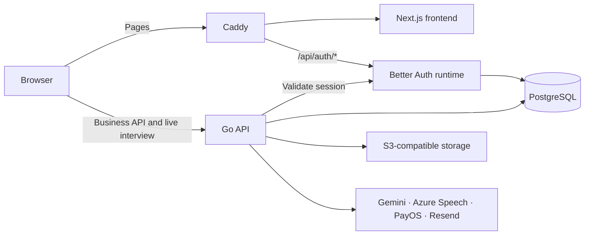

# RoleCue

AI-supported technical interview practice, with a moderated recruitment board.

RoleCue helps candidates prepare from a job description, practise with a spoken AI interviewer, and review evidence-based feedback. Recruiters publish reviewed job postings, configure interview questions and scoring rubrics, and evaluate completed applications. Administrators manage moderation, accounts, interview operations and financial reporting.

[Getting started](#getting-started) · [Architecture](#architecture) · [Development](#development) · [Documentation](#documentation) · [Contributing](#contributing)

## What you can do

| Workspace     | Main workflows                                                                                                                                                                                                                         |
| ------------- | -------------------------------------------------------------------------------------------------------------------------------------------------------------------------------------------------------------------------------------- |
| Candidate     | Upload a job-description PDF, review extracted requirements, configure a practice session, answer spoken questions, and review interview history and score reports. Browse approved vacancies and submit an application with a PDF CV. |
| Recruiter     | Prepare job postings, generate and review question banks, maintain scoring rubrics, configure the company interviewer, fund interview capacity, and record application decisions.                                                      |
| Administrator | Moderate postings, manage account access, review interview operations and access audits, maintain evaluation guidance and voice profiles, and inspect billing and revenue.                                                             |

The interface supports English and Vietnamese. Interview questions, answers and AI feedback remain in English. The interview room supports 3D avatars and environment scenes, with fallback presentation when WebGL or media capabilities are unavailable. Camera and microphone capture require explicit browser permission.

## Architecture

This monorepo contains three application services. Caddy provides the shared browser origin for the frontend and authentication endpoints; business requests go directly to the Go API.



| Layer                    | Implementation                                                                                       |
| ------------------------ | ---------------------------------------------------------------------------------------------------- |
| Frontend                 | Next.js 16, React 19, TypeScript, Tailwind CSS 4 and shadcn/ui                                       |
| Client state             | TanStack Query for remote data, React Hook Form and Zod for forms, Zustand for workspace preferences |
| Business API             | Go, Gin, PostgreSQL and sqlc queries                                                                 |
| Authentication           | Standalone Bun service running Better Auth; shared PostgreSQL session storage                        |
| AI and media             | Gemini, Azure AI Speech, Three.js/VRM, Avaturn and Blender conversion                                |
| Storage and payments     | S3-compatible object storage and PayOS                                                               |
| Development and delivery | Docker Compose, Air, Caddy, GitHub Actions and GHCR                                                  |

### Repository layout

```text
api/          Go API, migrations, background jobs and integration tests
frontend/     Next.js application, shared UI, unit tests and Playwright tests
auth/         Better Auth runtime and authentication configuration
.docker/      Local, build and deployment Compose definitions
.caddy/       Local and production ingress configuration
.githooks/    Cross-platform staged-file checks
.github/      CI, image scanning and deployment workflows
docs/         Product specs, implementation notes, protocols and security notes
```

## Getting started

### Prerequisites

For the container-based stack, install Git, Docker with Docker Compose v2, and Make in a POSIX shell. On Windows, use WSL for the Make/Compose workflow. You will also need credentials for the external services enabled in your environment; this is not a zero-configuration demo.

For host-side development and checks, use the versions pinned by CI and the package manifests: **Go 1.27.4**, **Bun 1.4.2**, **Node.js 24.20.0**, and **Python 3.11+** with `venv`.

### 1. Clone and configure

```sh
git clone https://github.com/cog-forge/rolecue.git
cd rolecue
cp .env.example .env
cp auth/.env.example auth/.env
cp frontend/.env.example frontend/.env
```

Copy templates only for a fresh checkout. Fill in the values before starting services; preserve existing environment files when updating a working installation.

| File            | What belongs here                                                                                                                  |
| --------------- | ---------------------------------------------------------------------------------------------------------------------------------- |
| `.env`          | Database and business API configuration, S3 storage, Gemini, PayOS, Azure Speech and API email settings                            |
| `auth/.env`     | Authentication database URL, signing secret, OAuth credentials, authentication email settings and the shared internal admin secret |
| `frontend/.env` | Public API/Avaturn URLs and the non-secret social-provider display allowlist                                                       |

Docker Compose takes frontend public values from the root `.env` and passes them into the frontend container; these process values override `frontend/.env`. Use `frontend/.env` for host-side `bun run dev`.

The API requires `LLM_API_KEY` and the three `PAYOS_*` credentials at startup. Configure S3-compatible storage for PDF, CV, avatar and recording workflows. Set a stable `BETTER_AUTH_SECRET`, and keep `ADMIN_AUTH_INTERNAL_SECRET` consistent between the API and auth service. See [auth setup](auth/README.md) for the complete environment contract and provider callbacks.

Azure Speech credentials enable speech features. GLB-to-VRM conversion additionally needs Blender and the VRM extension, with conversion explicitly enabled and the source-usage/license settings configured. The API development image includes Poppler for PDF text extraction; scanned PDFs still need selectable text/OCR before upload.

`NEXT_PUBLIC_*` values are public and embedded at build time. Keep provider credentials, database passwords and signing secrets server-side. Use `localhost` consistently for local browser access so authentication cookies and API origins agree.

### 2. Start the stack

```sh
make dev
```

This builds and starts PostgreSQL, runs migrations, and starts auth, the Go API with Air, Next.js and Caddy. Source changes are mounted into the development containers.

| Service                                           | Local address                                            |
| ------------------------------------------------- | -------------------------------------------------------- |
| Application, including same-origin authentication | <http://localhost:3000>                                  |
| Go business API                                   | <http://localhost:8080>                                  |
| Auth runtime                                      | <http://localhost:3001>                                  |
| Next.js directly, without the auth ingress        | <http://localhost:3002>                                  |
| PostgreSQL                                        | `localhost:5432` by default; configurable with `DB_PORT` |

Use port **3000** for normal application access. Opening Next.js directly does not provide Caddy's `/api/auth/*` routing.

```sh
make dev-api       # API and its database/auth dependencies
make dev-frontend  # Full local stack; also used by make dev
make dev-down      # Stop the stack while preserving database volumes
```

If you run Next.js on the host, install its dependencies and run `bun run dev` inside `frontend/`; keep the API, auth and same-origin routing configured. See [frontend setup](frontend/README.md) for details.

## Development

### Install local tooling

From the repository root:

```sh
python3 .githooks/setup.py
```

On Windows, `py .githooks/setup.py` works in PowerShell without WSL or Make. The script installs the pinned pre-commit runner, frontend and Go dependencies, and enables hooks for the current worktree. It does not start services or apply migrations, and preserves existing custom hooks.

The commit hook checks staged files for formatting, lint, syntax, conflict markers and accidental credentials. It does not automatically stage or rewrite files.

### Run checks

| Command                                                        | Purpose                                                                           |
| -------------------------------------------------------------- | --------------------------------------------------------------------------------- |
| `make precommit`                                               | Run local hook checks against all tracked files                                   |
| `make frontend-check`                                          | Frontend format, lint, types, unit/component tests and production build           |
| `make check`                                                   | Local hooks, API checks and frontend checks                                       |
| `make ci`                                                      | Above, plus Go race/vulnerability checks and the frontend dependency audit        |
| `make -C api test-integration`                                 | Database integration tests using an explicitly supplied disposable `DATABASE_URL` |
| `cd auth && bun run lint && bun run typecheck && bun run test` | Auth runtime checks                                                               |
| `make image-scan IMAGE=rolecue-api:local`                      | Scan a locally built runtime image with Trivy                                     |

To check all files without Make, run `python3 .githooks/setup.py run --all-files` (`py` on Windows).

For browser tests:

```sh
cd frontend
bun install --frozen-lockfile
bunx playwright install chromium
bun run build
bun run test:e2e
```

Playwright starts the standalone production build on port **3100**. Set `PLAYWRIGHT_CHROMIUM_EXECUTABLE_PATH` to use an existing compatible Chromium executable. Most browser tests mock API responses; they do not validate real payment, OAuth, email or AI-provider integrations. Tests requiring live services or real media fixtures are explicitly configured separately.

For visual review, `bun run dev` exposes `/state-preview`, where loading, error, empty and AI states stay visible until another scenario is selected. The preview includes a simulated retry and is unavailable in production.

### Database changes

Compose applies migrations before starting local application services. The API binary itself does not migrate the database. Migrations live in [`api/migrations`](api/migrations); host-side migration commands are available in [`api/Makefile`](api/Makefile).

Use a disposable database for integration tests. Avoid editing an already-applied migration; add a new migration for schema changes.

## Delivery

[GitHub Actions](.github/workflows/ci.yml) checks the API, auth and frontend, runs database integration and Playwright tests, and builds/scans all three application images. **CI checks** is the aggregate required gate. Trivy blocks HIGH/CRITICAL findings in final runtime images; dependency-audit exceptions are documented in [security notes](docs/security-notes.md).

Pull requests run checks without publishing images. Eligible successful main/manual runs publish the scanned artifacts to GHCR:

- `ghcr.io/cog-forge/rolecue-api`
- `ghcr.io/cog-forge/rolecue-auth`
- `ghcr.io/cog-forge/rolecue-frontend`

Frontend public configuration is fixed when the image is built. Changing the deployed API URL requires a new frontend build. Deployment uses [`.docker/compose.deploy.yaml`](.docker/compose.deploy.yaml) and the values documented in [`.docker/deploy.env.example`](.docker/deploy.env.example); use a unique image tag or digest to identify the release.

```sh
cp .docker/deploy.env.example .docker/deploy.env
# Configure the deployment environment and release tag first.
make deploy-pull
make deploy-up
```

## Documentation

- [Frontend setup and conventions](frontend/README.md)
- [Authentication, cookies and environment ownership](auth/README.md)
- [Live interview WebSocket protocol](docs/interview-ws-protocol.md)
- [Scoring rubric specification](docs/SPEC-scoring-rubrics.md)
- [Avatar conversion specification](docs/KAN-122-GLB-TO-VRM-SPEC.md)
- [Privacy controls](docs/privacy-controls.md)
- [Security notes and audit exceptions](docs/security-notes.md)
- [RoleCue design contract](https://github.com/cog-forge/role-cue-design/blob/main/DESIGN.md)

Some documents under `docs/` record earlier plans or implementation stages. Check their stated scope against current source and tests before using them as setup instructions.

## Contributing

Open an [issue](https://github.com/cog-forge/rolecue/issues) for a reproducible bug or a scoped proposal. For a code change, branch from the latest `main`, keep the diff focused, and include the relevant validation in the pull request. Use conventional commit messages such as `fix(frontend): prevent sidebar search overlap`.

Follow the instructions for the component you change, including [`frontend/AGENTS.md`](frontend/AGENTS.md). Keep generated output, environment files, credentials and local review notes out of commits. CI must pass before merging.

## License

This repository currently has no project-wide license file. Third-party assets and components retain their own licenses where included.
