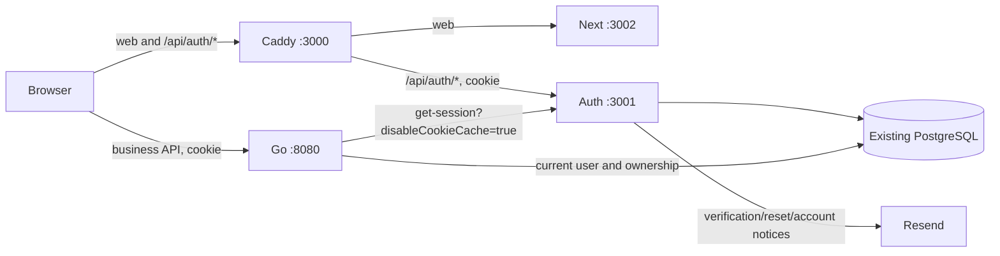

# RoleCue auth runtime

Standalone Bun 1.4.2 / Better Auth **1.7.7**, port **3001**. Reuses `api/migrations` and the existing PostgreSQL identity/session tables. Go remains responsible for current role, lock, verified email and business ownership. Multiple concurrent browser sessions remain supported.

## Request flow



Auth sets the same `rolecue` cookies, 14-day sessions with one-day renewal, no cookie cache. Go relays validated renewal/clear cookies. Logout revokes the current session; reset and Admin ban revoke all sessions; unlock never revives them. Missing/expired/revoked sessions return 401, a valid session rejected by current application policy returns 403, and auth/DB transport failure returns 503.

## Environment ownership

Copy templates only for a fresh checkout. Preserve existing secrets when migrating.

| File / owner     | Configuration                                                                                                                                                                                             |
| ---------------- | --------------------------------------------------------------------------------------------------------------------------------------------------------------------------------------------------------- |
| `auth/.env`      | `APP_URL`, `AUTH_BASE_URL`, stable `BETTER_AUTH_SECRET`, `BETTER_AUTH_DATABASE_URL`, cookie prefix/domain, internal Admin secret, OAuth pairs, Resend sender/key/template IDs, support email, `PORT=3001` |
| `frontend/.env`  | Public build-time `NEXT_PUBLIC_API_BASE_URL`; non-secret `AUTH_SOCIAL_PROVIDERS=google,github,facebook` display allowlist matching enabled provider pairs                                                 |
| root `.env` / Go | Existing business configuration, `AUTH_UPSTREAM_URL`, `AUTH_BASE_URL`, same cookie prefix/domain and Admin secret; `AUTH_SECURE_COOKIES`, `AUTH_SESSION_TIMEOUT`                                          |

| Deployment   | APP_URL / AUTH_BASE_URL       | AUTH_UPSTREAM_URL                     | Cookie configuration                            |
| ------------ | ----------------------------- | ------------------------------------- | ----------------------------------------------- |
| Native local | `http://localhost:3000`       | `http://localhost:3001`               | prefix `rolecue`, empty domain, Go secure=false |
| Production   | `https://rolecue.dorriss.com` | `http://auth:3001` on private network | domain `dorriss.com`, Go secure=true            |

`APP_URL` is the frontend origin for account email links; browser verification/reset and OAuth callback targets remain public URLs. `AUTH_BASE_URL` is the public auth origin, never `auth:3001`. Both public origins are exact trusted origins. Keep them equal for the preserved same-origin `/api/auth/*` topology. Provider console redirect URIs remain `${AUTH_BASE_URL}/api/auth/callback/google`, `/github`, `/facebook`. No redirect URI change is needed when the public origin stays unchanged.

New `AUTH_UPSTREAM_URL` takes precedence over legacy Go `BETTER_AUTH_URL` and requires `AUTH_BASE_URL`. Without the new variable, Go accepts the legacy one-origin configuration. The auth runtime requires the new names. Cookie security follows the public HTTPS origin independently of private HTTP transport. Deploy the private service on a trusted network; use TLS internally if that network is not trusted.

Move OAuth, database, signing and mail secrets out of Next. Do not rotate the signing secret, prefix, cookie domain or session tables during cutover. Share `ADMIN_AUTH_INTERNAL_SECRET` only between Go and auth. Admin plugin writes still require an administrator session in addition to that secret. Neither frontend nor edge injects it.

## Native development

From the repository root:

```sh
cp auth/.env.example auth/.env
# Populate runtime secrets; configure root and frontend using their templates.
bun install --cwd auth --frozen-lockfile
bun install --cwd frontend --frozen-lockfile
make -C api migrate
```

Caddy routing is configured in the root `Caddyfile`. Docker Compose pulls missing images automatically. To pull PostgreSQL/Caddy images explicitly, from the repository root:

```sh
docker compose --env-file .env -f .docker/compose.local.yaml pull
```

Run in three terminals, from the repository root:

```sh
make -C api dev                # PostgreSQL + Caddy + migrations + Go/Air
cd auth && bun run dev         # auth on :3001 with Bun watch
cd frontend && bun run dev     # Next on :3002; open Caddy at http://localhost:3000
```

To start only PostgreSQL and Caddy, use `make -C api db-up`. No Caddy installation on the host is required. Air/sqlc install on first use. Each service reads its own environment.

Open `http://localhost:3000/login`. Health: auth `/healthz` (process) and `/readyz` (database reachable, migrations applied and not dirty); Go `/health`. Readiness returns 503 otherwise. Startup validates config; requests and logs never expose secrets or raw provider/database errors. Pool size is 10, connection/query/statement timeout is 5s; shutdown drains and closes the pool with a 10s deadline. Auth never applies migrations automatically.

## Deployment boundary

`.docker/compose.local.yaml` runs PostgreSQL and Caddy. Caddy publishes loopback port 3000 and routes `/api/auth/*` directly to native auth on port 3001; all other web paths go to native Next on port 3002. Open `http://localhost:3000`, not the Next listener. No auth route, rewrite or custom transport proxy remains in Next. Go calls auth directly.

Caddy uses host networking to reach native services on the Linux host and binds only `127.0.0.1:3000`. PostgreSQL retains its existing bridge/volume configuration. On Docker Desktop, [enable host networking (4.34+)](https://docs.docker.com/engine/network/drivers/host/#docker-desktop) or supply deployment-specific bridge/host routing; this committed dev topology is validated on Linux. Caddy forwards WebSocket upgrades for Next hot reload. Its `/_dev/health` reports Caddy process health independently of native services; the web/auth routes return 503 until those services start. `make -C api db-up` now starts both infrastructure services.

The Caddyfile preserves auth paths, cookies, Origin and redirects, strips reserved Admin headers and the client `Forwarded` header, and maps connection failures to 503. Runtime access logs are disabled; request error logs are excluded to avoid token-bearing URLs. Provider callbacks and APP_URL/AUTH_BASE_URL stay on port 3000; no provider-console URL change is needed.

Independent images remain available for deployment. Builds use frozen lockfiles and contain no `.env`; auth runs as non-root. Production TLS and orchestration remain deployment-owned, but ingress must route `/api/auth/*` directly to auth since Next no longer serves that path. The committed Caddyfile is HTTP development configuration. Never use `down -v` during cutover or rollback.

Rollback: restore the old Next runtime and Go legacy upstream together, retaining the same database, secret and cookie configuration. No schema rollback is involved. Sessions created by either runtime remain in the same store.

## Verification

```sh
cd auth
bun run format:check && bun run lint && bun run typecheck && bun run test && bun run build
bun audit --audit-level=high
```

Auth checks and images are not wired into CI, Git hooks or root Make checks in this PR. Install dependencies explicitly with `bun install --cwd auth --frozen-lockfile`.

Live-provider acceptance remains a separate check: use designated test accounts to receive verification/reset mail and complete Google/GitHub/Facebook consent. Fixture success is not proof of provider console configuration or email delivery. Record pass/fail only; never record tokens, cookies, password fields, mail links or provider response bodies.

Account security UI from PR #43 / KAN-212 and dirty KAN-108 work is deliberately not merged here. Extract runtime first, then rebase/reconcile those changes without losing WIP. No TOTP endpoints, schema redesign or JWT authority are added.
