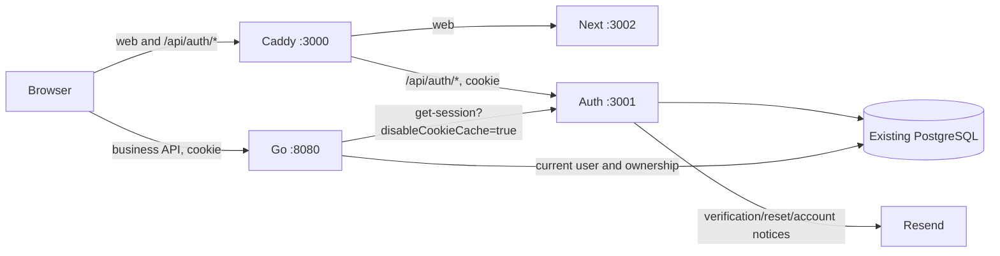

# RoleCue auth runtime

Standalone Bun 1.4.2 / Better Auth **1.7.7**, port **3001**. Reuses `api/migrations` and the existing PostgreSQL identity/session tables. Go remains responsible for current role, lock, verified email and business ownership. Multiple concurrent browser sessions remain supported.

## Request flow



Auth sets the same `rolecue` cookies, 14-day sessions with one-day renewal, no cookie cache. Go relays validated renewal/clear cookies. Logout revokes the current session; reset and Admin ban revoke all sessions; unlock never revives them. A password change (`/change-password`) revokes every other session while the current one stays signed in; the server forces `revokeOtherSessions` so clients cannot skip it (`src/password-change-sessions.ts`).

Sign-in, password reset, verification mail and two-factor code checks are rate limited per client IP in PostgreSQL (`rate_limits`, migration 000020; limits in `src/rate-limit.ts`), independent of `NODE_ENV`. The IP is read from `X-Forwarded-For`, which Caddy appends to. Missing/expired/revoked sessions return 401, a valid session rejected by current application policy returns 403, and auth/DB transport failure returns 503.

## Environment ownership

Copy templates only for a fresh checkout. Preserve existing secrets when migrating.

| File / owner     | Configuration                                                                                                                                                                                             |
| ---------------- | --------------------------------------------------------------------------------------------------------------------------------------------------------------------------------------------------------- |
| `auth/.env`      | `APP_URL`, `AUTH_BASE_URL`, stable `BETTER_AUTH_SECRET`, `BETTER_AUTH_DATABASE_URL`, cookie prefix/domain, internal Admin secret, OAuth pairs, Resend sender/key/template IDs, support email, `PORT=3001` |
| `frontend/.env`  | Public build-time `NEXT_PUBLIC_API_BASE_URL`; non-secret `AUTH_SOCIAL_PROVIDERS=google,github,facebook` display allowlist matching enabled provider pairs                                                 |
| root `.env` / Go | Existing business configuration, `AUTH_UPSTREAM_URL`, `AUTH_BASE_URL`, same cookie prefix/domain and Admin secret; `AUTH_SECURE_COOKIES`, `AUTH_SESSION_TIMEOUT`                                          |

| Deployment | APP_URL / AUTH_BASE_URL       | AUTH_UPSTREAM_URL                     | Cookie configuration                            |
| ---------- | ----------------------------- | ------------------------------------- | ----------------------------------------------- |
| Local      | `http://localhost:3000`       | `http://auth:3001` (set by Compose)   | prefix `rolecue`, empty domain, Go secure=false |
| Production | `https://rolecue.dorriss.com` | `http://auth:3001` on private network | domain `dorriss.com`, Go secure=true            |

`APP_URL` is the frontend origin for account email links; browser verification/reset and OAuth callback targets remain public URLs. `AUTH_BASE_URL` is the public auth origin, never `auth:3001`. Both public origins are exact trusted origins. Keep them equal for the preserved same-origin `/api/auth/*` topology. Provider console redirect URIs remain `${AUTH_BASE_URL}/api/auth/callback/google`, `/github`, `/facebook`. No redirect URI change is needed when the public origin stays unchanged.

New `AUTH_UPSTREAM_URL` takes precedence over legacy Go `BETTER_AUTH_URL` and requires `AUTH_BASE_URL`. Without the new variable, Go accepts the legacy one-origin configuration. The auth runtime requires the new names. Cookie security follows the public HTTPS origin independently of private HTTP transport. Deploy the private service on a trusted network; use TLS internally if that network is not trusted.

Move OAuth, database, signing and mail secrets out of Next. Do not rotate the signing secret, prefix, cookie domain or session tables during cutover. Share `ADMIN_AUTH_INTERNAL_SECRET` only between Go and auth. Admin plugin writes still require an administrator session in addition to that secret. Neither frontend nor edge injects it.

## Local development

From the repository root:

```sh
cp .env.example .env
cp auth/.env.example auth/.env
# Populate runtime secrets; configure root and frontend using their templates.
make dev          # PostgreSQL, migrations, auth, Go/Air, Next and Caddy
make dev-api      # only Go and its dependencies (PostgreSQL, migrations, auth)
make dev-down     # stop the stack; volumes are kept
```

Caddy routing is configured in `.caddy/Caddyfile.local`. Containers run as the host UID/GID and bind-mount the sources, so Bun watch, Air and Next hot reload pick up edits; Air polls because file events do not cross every bind mount. Dependencies install inside the containers on start. Each service reads its own environment; Compose overrides database URLs and service hosts for the container network.

Open `http://localhost:3000/login`. Health: auth `/healthz` (process) and `/readyz` (database reachable, migrations applied and not dirty); Go `/health`. Readiness returns 503 otherwise. Startup validates config; requests and logs never expose secrets or raw provider/database errors. Pool size is 10, connection/query/statement timeout is 5s; shutdown drains and closes the pool with a 10s deadline. Auth never applies migrations automatically.

## Deployment boundary

`.docker/compose.local.yaml` runs every local service on one Compose network. Caddy publishes loopback port 3000 and routes `/api/auth/*` directly to `auth:3001`; all other web paths go to `frontend:3002`. Open `http://localhost:3000`, not the Next listener. No auth route, rewrite or custom transport proxy remains in Next. Go calls auth directly.

Every published port binds loopback only: Caddy `3000`, auth `3001`, Go `8080` and PostgreSQL `5432`. Caddy starts after auth and Next report healthy and forwards WebSocket upgrades for Next hot reload. Its `/_dev/health` reports Caddy process health independently of the upstream services; the web/auth routes return 503 while those restart.

The Caddyfile preserves auth paths, cookies, Origin and redirects, strips reserved Admin headers and the client `Forwarded` header, and maps connection failures to 503. Runtime access logs are disabled; request error logs are excluded to avoid token-bearing URLs. Provider callbacks and APP_URL/AUTH_BASE_URL stay on port 3000; no provider-console URL change is needed.

Independent images remain available for deployment. Builds use frozen lockfiles and contain no `.env`; auth runs as non-root. `.caddy/Caddyfile.local` is HTTP development configuration. Production uses `.docker/compose.deploy.yaml` with `.caddy/Caddyfile.deploy`, whose ingress routes `/api/auth/*` directly to auth since Next no longer serves that path. Never use `down -v` during cutover or rollback.

Rollback: restore the old Next runtime and Go legacy upstream together, retaining the same database, secret and cookie configuration. No schema rollback is involved. Sessions created by either runtime remain in the same store.

## Verification

```sh
cd auth
bun run format:check && bun run lint && bun run typecheck && bun run test && bun run build
bun audit --audit-level=high
```

Auth checks and images are not wired into CI, Git hooks or root Make checks in this PR. Install dependencies explicitly with `bun install --cwd auth --frozen-lockfile`.

Live-provider acceptance remains a separate check: use designated test accounts to receive verification/reset mail and complete Google/GitHub/Facebook consent. Fixture success is not proof of provider console configuration or email delivery. Record pass/fail only; never record tokens, cookies, password fields, mail links or provider response bodies.

Two-factor authentication (KAN-108): `src/options.ts` activates the pinned two-factor plugin using the existing schema. Password confirmation and a verified authenticator code are required for enrollment; backup codes are encrypted, single-use and regenerable. Email/SMS OTP endpoints remain disabled. TOTP challenges password sign-in; OAuth keeps the provider's own security policy. Frontend provider buttons use `AUTH_SOCIAL_PROVIDERS`, never provider secrets.

Admin two-factor enforcement (KAN-265): Go, not Better Auth, enforces it. With `ADMIN_REQUIRE_MFA=true` (Go config `auth.admin_require_mfa`, default `false`), `Authenticate` rejects a session of an Admin whose `users.two_factor_enabled` is false with `403 ADMIN_MFA_REQUIRED`; the frontend then sends the Admin to account security to enrol an authenticator. `ADMIN_MFA_GRACE_UNTIL` (RFC3339, default empty = none) lets Admins without two-factor in until that instant. Candidates and Recruiters stay optional. Enrolment itself runs against this service and is never blocked. Grace length and the lost-device recovery path are still product decisions, so this stays a flag.
